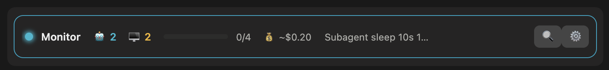
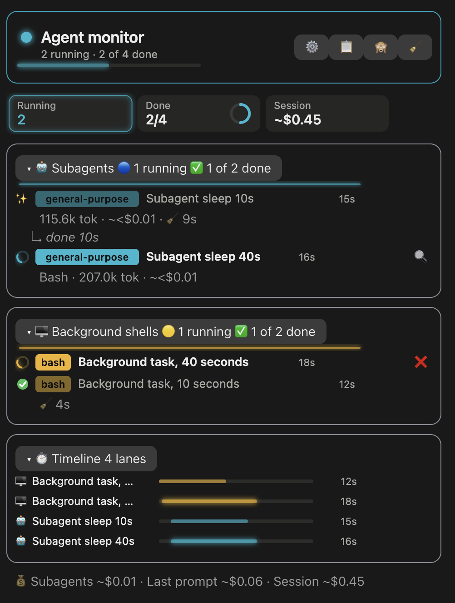
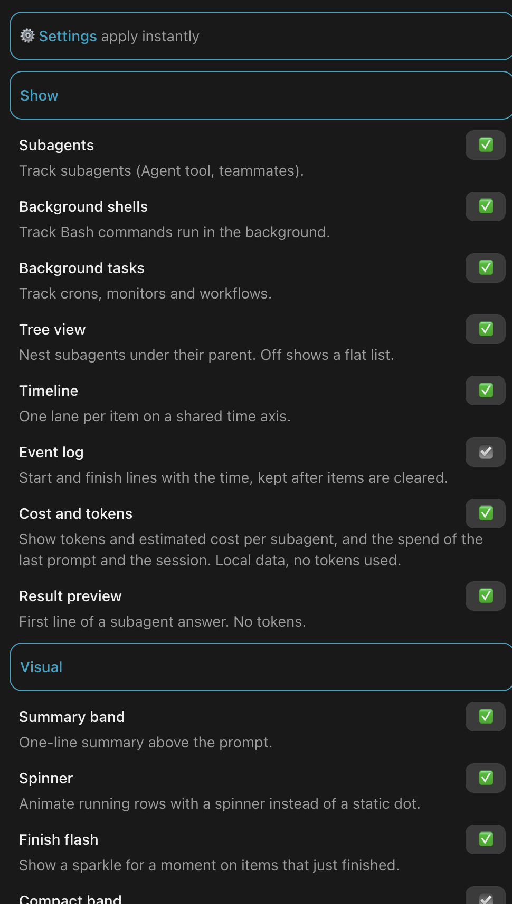

# claude-agent-monitor

Claude Code mod that shows every running subagent, background shell and task in a side panel, plus a live band above the prompt. It costs zero model tokens by default.



## What it tracks

| Kind | Source | Ends when |
| --- | --- | --- |
| Subagents | The `Agent` tool and teammates, nested under their parent in tree view | The agent's final turn completes, or it is aborted |
| Background shells | `Bash` calls with `run_in_background` | Claude Code sends the task notification |
| Monitors | The `Monitor` tool | Its timeout expires, or never if it is persistent |
| Workflows | The `Workflow` tool | Task notification |
| Scheduled tasks | `CronCreate` (recurring or once) and `ScheduleWakeup` | The scheduled run fires, or `CronDelete` is called |

Each item has a state: running, done 🟢, failed 🔴, stopped ⛔, or stuck (orange, after a configurable time).

## Features

- **Band** above the prompt: a glowing state orb, live counts per kind, overall progress, the spend of the last prompt, the latest items with their time, and shortcuts to the panel (🔍) and settings (⚙️).
- **Side panel** with a status header, summary tiles (running, done with a progress ring, cost), collapsible sections, a running-only toggle and a tree or flat list. Each row takes two lines: spinner, type, name and time, then tool, tokens and cost.
- **Cost and tokens**: tokens and estimated cost on each subagent row, plus a footer with the subagent total, the last prompt and the session. Taken from Claude Code's own `/cost` ledger, so it uses no tokens.
- **Live feedback**: a spinning ring on running rows, a sparkle on items that just finished, soft glow and pulse on running work, and an optional compact band. Animations stay in phase between refreshes and stop when the system asks for reduced motion.
- **Result preview**: the first line of a finished subagent's answer appears under its row, at no token cost.
- **Row buttons**: 🔍 opens a running agent, ❌ dismisses a shell or task.
- **Alerts**: toast and chime when an item finishes or fails.
- **Timeline**: one glowing bar per item on a shared time axis, and an optional **event log**.
- **Auto-clear** of finished items and **stuck** detection.
- **Themes**: Ocean, Sunset, Forest, Mono, Pastel.
- **AI summary** (off by default): sends each finished subagent's last message to a small model for a one-line summary. This spends tokens.

## Screenshots

**Panel.** Status header, summary tiles, one section per kind with running and done counts, and the timeline.



**Settings.** Options are grouped as Show, Visual, Behavior and Alerts, and every one applies instantly.



## Install

```
/plugin marketplace add OriolClariana/claude-agent-monitor
/plugin install agent-monitor@claude-agent-monitor
```

If your organization blocks marketplaces, clone the repo and add this to `~/.claude/settings.json`:

```json
{
  "env": {
    "CLAUDE_CODE_PLUGIN_DIRS": "/path/to/claude-agent-monitor",
    "CLAUDE_CODE_PLUGIN_DIR_WATCH": "1"
  }
}
```

## Usage

- `/monitor` opens the panel. With `autoOpenPane` on, it also opens by itself when something starts, and with `autoClosePane` on it closes again when nothing is left.
- `/monitor-settings` opens the settings pane.
- In the panel header, 👁️/🙈 switches between all items and running ones only, 🌲/📋 switches tree and list, 🧹 clears finished items.

## Options

All options live in `userConfig` and can be changed live in `/monitor-settings`.

| Option | Default | What it does |
| --- | --- | --- |
| `showSubagents` | on | Track subagents |
| `showShell` | on | Track background shells |
| `showTasks` | on | Track crons, monitors and workflows |
| `treeView` | on | Nest subagents under their parent, off for a flat list |
| `showBand` | on | One-line summary above the prompt |
| `showButtons` | on | Row buttons (view agent, dismiss, layout) |
| `autoOpenPane` | on | Open the panel when work starts |
| `showCost` | on | Tokens and estimated cost per subagent, plus last prompt and session spend |
| `showSpinner` | on | Spinner on running rows |
| `flashOnFinish` | on | Sparkle on items that just finished |
| `compactBand` | off | Shorter band without the latest item names |
| `cleanLayout` | on | Hide the help line, duplicate header counts, section mini-bars and the status lines under the sections |
| `showTiles` | on | Running, Done and cost tiles under the header |
| `glowEffect` | on | Soft glow on running bars, the Running tile and narrow-pane dots |
| `pulseEffect` | on | Running bars and glow slowly pulse (stops with reduced motion) |
| `autoClosePane` | on | Close the panel it opened by itself once nothing is running or listed. A panel opened with `/monitor` stays open. Needs `clearAfterSeconds` of 0 or more |
| `clearAfterSeconds` | 5 | Remove finished items after N seconds. `-1` keeps them all session, `0` removes them at once |
| `refreshSeconds` | 1 | Local polling interval, no tokens |
| `notifyToast` | on | Toast on finish or failure |
| `notifySound` | on | Chime on finish or failure |
| `showResultPreview` | on | First line of a finished subagent's answer |
| `aiSummary` | off | One-line AI summary, **uses tokens** |
| `stuckAfterSeconds` | 600 | Flag running items older than this. `0` turns it off |
| `theme` | 0 | 0 Ocean, 1 Sunset, 2 Forest, 3 Mono, 4 Pastel |
| `showTimeline` | on | Timeline section |
| `showLog` | off | Event log section |

## Options explained

Change any of them live in `/monitor-settings`, or in your plugin settings.

**What to track**
- `showSubagents`, `showShell`, `showTasks`: turn a kind off if it is noise for you. Off means it is neither listed nor counted in the band.

**Layout**
- `treeView`: on nests each subagent under the agent that started it. Off gives a flat list in start order, better when you only care about what is running right now.
- `showBand`: the one-line summary above the prompt. Turn it off if you only want the side panel.
- `showButtons`: the 🔍 and ❌ buttons on each row. Off gives a read-only panel.
- `showTimeline`: one lane per item on a shared time axis, useful to spot what overlaps or runs long.
- `showLog`: start and finish lines with the time. They stay after items are cleared, so it works as a short history of the session.
- `theme`: Ocean, Sunset, Forest, Mono (no colour, for low-contrast terminals) or Pastel.

**Opening and closing**
- `autoOpenPane`: opens the panel by itself when something starts and nothing else is running.
- `autoClosePane`: closes the panel it opened once nothing is running or listed. A panel you open with `/monitor` stays open. Together with `autoOpenPane` the panel only exists while there is background work.
- `clearAfterSeconds`: how long finished items stay listed. `0` removes them at once, `-1` keeps them for the whole session (the panel then never auto-closes).

**Alerts**
- `notifyToast`: a toast when an item finishes or fails.
- `notifySound`: a short chime at the same moments. Turn it off in shared spaces.
- `stuckAfterSeconds`: running items older than this turn orange. Raise it for long builds, `0` turns it off.

**Visual**
- `cleanLayout`: the calm view. It hides the help line, the header counts that the tiles already show, the mini-bar on each section and the status lines under them. Turn it off to see everything.
- `showTiles`: three tiles under the header (Running, Done, and Failed, session cost or total). Needs the desktop app.
- Rows take two lines at most: status, type, name and time, then tool, tokens and cost. Timeline lanes are bars on a shared time axis, glowing while running.
- Each section header says how many are running and how many are done out of the total.
- Running rows show a spinning ring, and section headers are full-row buttons with a glowing, pulsing accent line while something runs. Animations keep their phase between refreshes, so they stay smooth.
- `glowEffect` and `pulseEffect`: a soft glow and a slow pulse on running work. They stop when the system asks for reduced motion.
- On a narrow pane the sections collapse into one dot per item, running ones glowing.
- Section titles (Subagents, Background shells...) are buttons: press to fold or unfold them.
- `/monitor-settings` groups the options as Show, Visual, Behavior and Alerts.

**Cost and looks**
- `showCost`: tokens and estimated cost on each subagent row, and a footer with subagent total, last prompt and session spend. The numbers come from Claude Code's own `/cost` ledger, so they are estimates and cost no tokens. Shells and tasks do not use the model, so they show none.
- `showSpinner`: running rows show a spinner in their kind colour. Off gives a static dot.
- `flashOnFinish`: a sparkle replaces the status dot for a moment when an item finishes, and in the band title.
- `compactBand`: the band keeps counts, progress and cost, and drops the names of the latest items.

**Details**
- `showResultPreview`: the first line of a finished subagent's answer under its row. No tokens.
- `aiSummary`: sends each finished subagent's last message to a small model for a one-line summary. **This spends tokens**, so it is off by default.
- `refreshSeconds`: how often the state is polled. It is local only, lower values feel more live and cost a little CPU.

## How endings are detected

- Shells, monitors and tasks end on their task notification, matched by tool-use id or task id. A non-persistent `Monitor` also ends at its own timeout as a fallback.
- `CronDelete` ends the job whose id `CronCreate` reported. A cron created before the mod loaded is unknown to it, so deleting that one changes nothing here.

## Known limits

- If a notification is missed, the item stays running and turns orange after `stuckAfterSeconds`. Dismiss it with ❌.

## Develop

```
claude plugin validate .
claude plugin test .
```

## Author

Oriol Marc Clariana Justes

## License

MIT, see [LICENSE](LICENSE).
